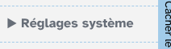
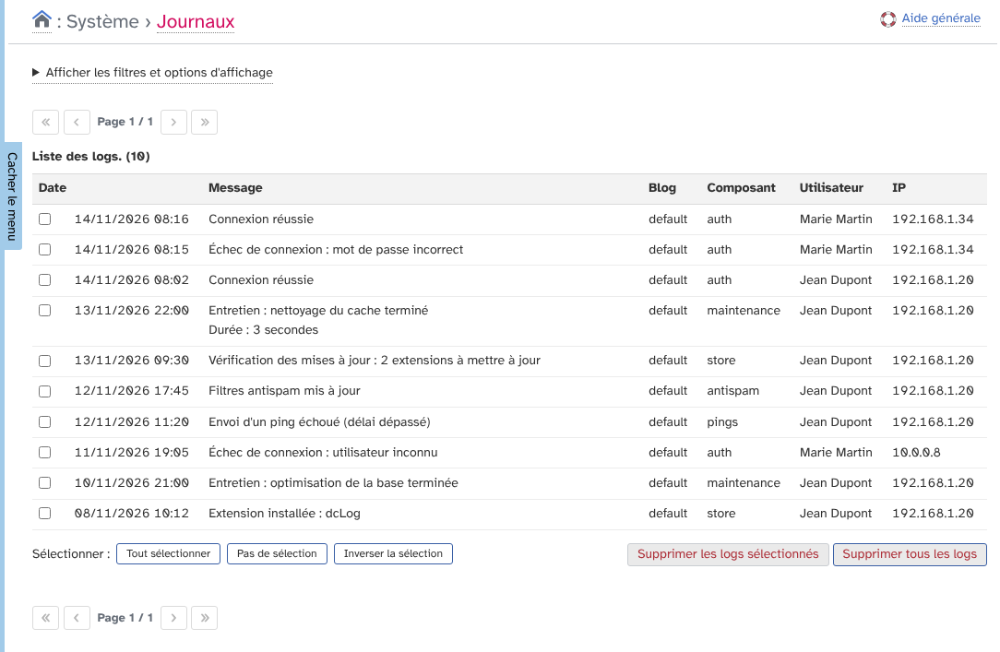
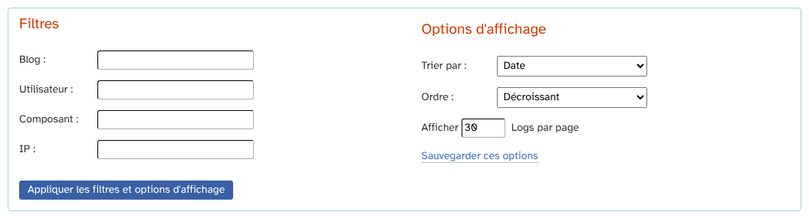
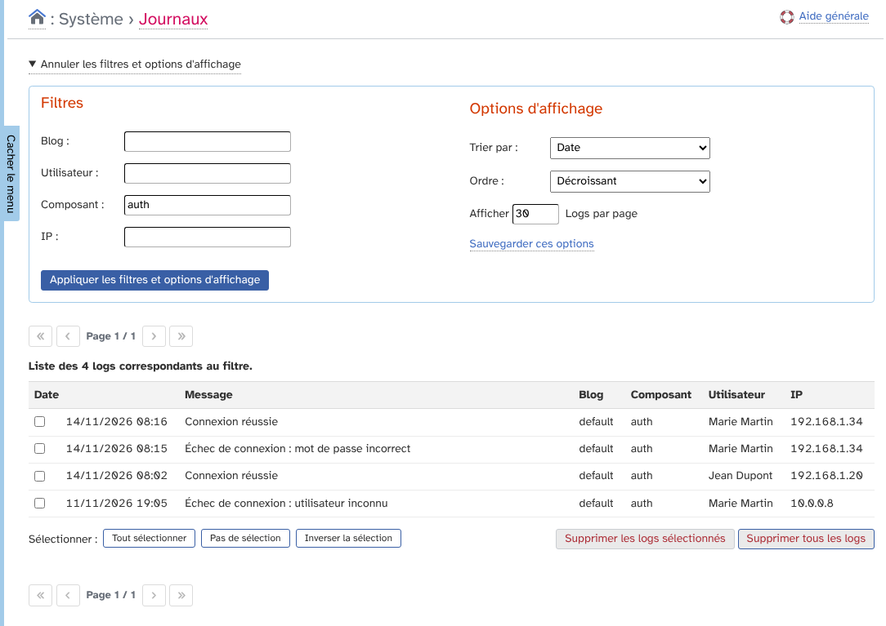
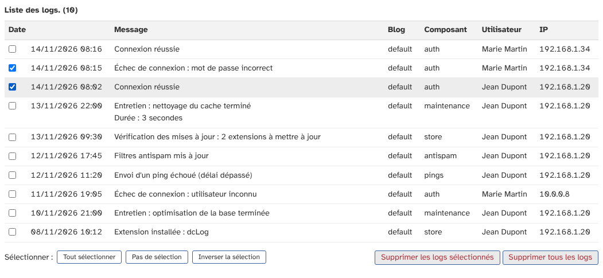
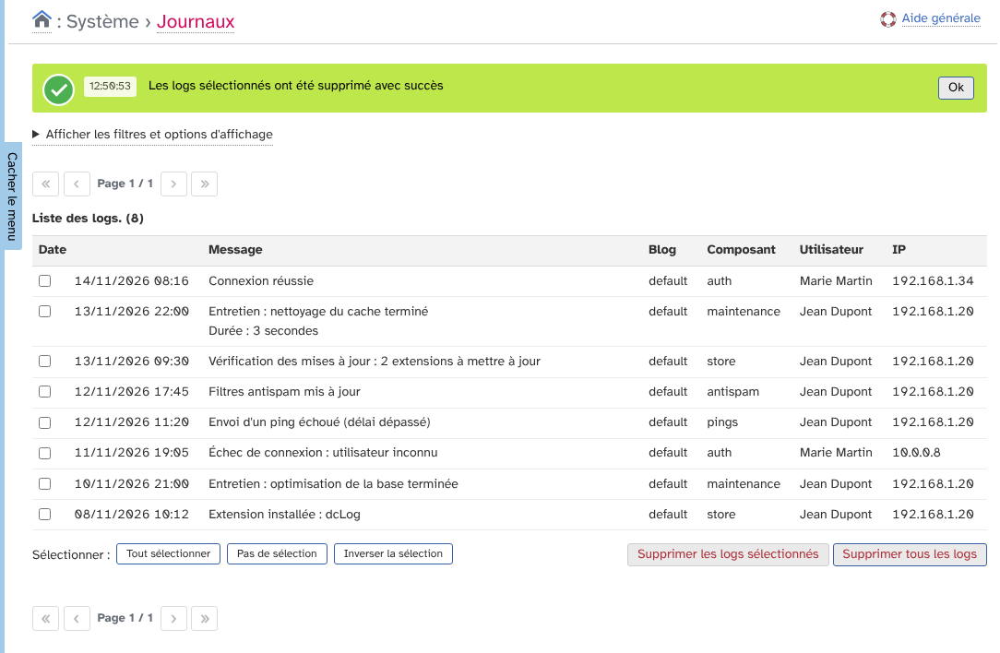
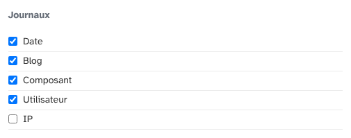
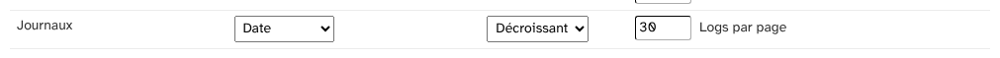
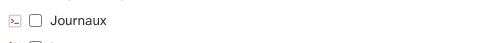
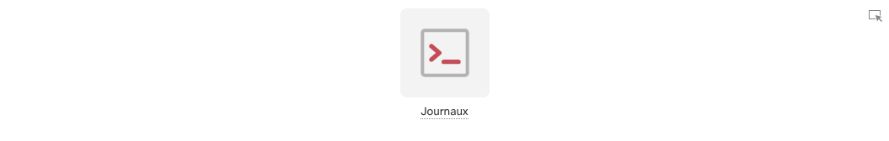

# Journaux (dcLog) : guide d'utilisation

Ce guide explique comment consulter et nettoyer les journaux (« logs ») de Dotclear avec l'extension dcLog. Dotclear et ses extensions y enregistrent des événements : connexions et échecs de connexion, entretien, vérifications de mises à jour, antispam, pings, etc.

L'extension est réservée aux super administrateurs.

## Sommaire

1. [Ouvrir la liste des journaux](#ouvrir-la-liste-des-journaux)
2. [Lire la liste](#lire-la-liste)
3. [Filtrer et trier](#filtrer-et-trier)
4. [Effacer des logs](#effacer-des-logs)
5. [Préférences](#préférences)

## Ouvrir la liste des journaux

Dans le menu **Réglages système**, cliquez sur **Journaux**.

L'extension n'a pas de page de configuration : tout se passe sur cette page.

## Lire la liste

La page affiche tous les logs, du plus récent au plus ancien, avec leur nombre total en haut du tableau.

Chaque ligne a six informations.

* **Date** : la date et l'heure de l'événement.
* **Message** : ce qui s'est passé. Les messages sur plusieurs lignes sont affichés tels quels.
* **Blog** : l'identifiant du blog concerné.
* **Composant** : la partie de Dotclear ou l'extension qui a écrit le log, par exemple `auth`, `maintenance`, `store`, `antispam` ou `pings`.
* **Utilisateur** : la personne concernée. « inconnu » s'affiche quand l'événement n'est lié à aucun utilisateur.
* **IP** : l'adresse IP d'où vient l'événement.

Si aucun log n'existe, la page affiche « Il n'y a aucun log ».

## Filtrer et trier

Cliquez sur **Afficher les filtres et options d'affichage** pour ouvrir les filtres.

Quatre filtres sont disponibles : **Blog**, **Utilisateur** (l'identifiant de la personne), **Composant** et **IP**. Chaque filtre cherche la valeur exacte : `auth` trouve les logs de connexion, mais `aut` ne trouve rien, et `192.168` ne trouve pas les adresses `192.168.1.20`. Les filtres se combinent.

Les options d'affichage règlent le tri (par date, message, blog, composant, utilisateur ou IP), son ordre (croissant ou décroissant) et le nombre de logs par page.

Cliquez sur **Appliquer les filtres et options d'affichage** pour voir le résultat. Le tableau indique alors combien de logs correspondent au filtre.

Pour garder les options d'affichage pour les prochaines visites, cliquez sur **Sauvegarder ces options**.

## Effacer des logs

Les logs s'accumulent avec le temps : un nettoyage régulier garde la base légère.

Pour effacer seulement certains logs :

1. Cochez les lignes à effacer. Les boutons **Tout sélectionner**, **Pas de sélection** et **Inverser la sélection** sous le tableau aident à choisir.
2. Cliquez sur **Supprimer les logs sélectionnés**.
3. Confirmez dans la fenêtre qui s'ouvre.

Une notification confirme la suppression.

Le bouton **Supprimer les logs sélectionnés** reste grisé tant qu'aucune ligne n'est cochée.

Pour tout effacer, cliquez sur **Supprimer tous les logs** et confirmez. Cette action vide complètement le journal, même si un filtre est actif.

La suppression est définitive et n'a aucune annulation possible.

## Préférences

Dans **Préférences**, onglet **Mes options**, un bloc **Journaux** règle l'affichage de la liste pour votre compte.

* **Colonnes** : choisissez de montrer ou de masquer les colonnes **Date**, **Blog**, **Composant**, **Utilisateur** et **IP**. La colonne Message est toujours affichée. La colonne IP est décochée par défaut, mais elle reste visible tant que vous n'avez pas enregistré vos options une première fois.

* **Tri** : le tri par défaut, son ordre et le nombre de logs par page.

Dans l'onglet **Mon tableau de bord**, cochez **Journaux** puis cliquez sur **Ajouter à mes favoris** pour afficher une icône de raccourci sur la page d'accueil.

